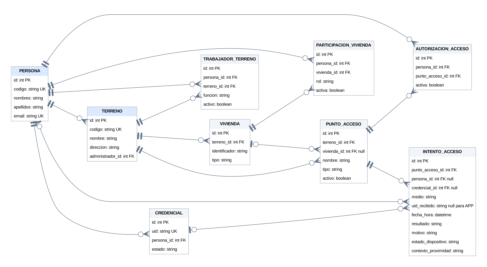
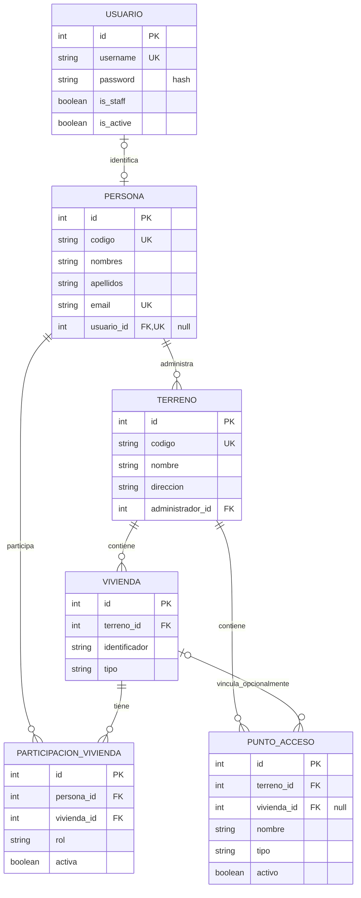
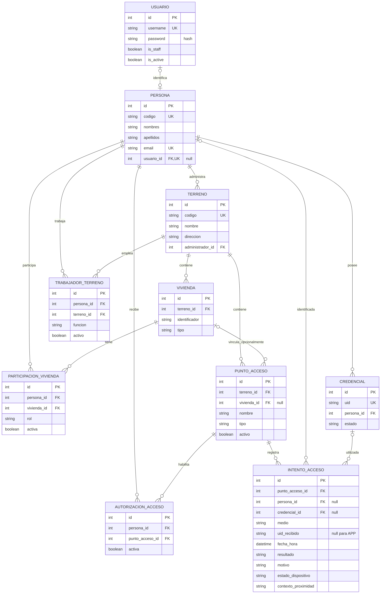

# SmartConnect · Entrega 2 · Login JWT y segundo avance

API REST local para SmartConnect (Programación Back End, TI3041). Usa Django 5.2, Django REST Framework 3.16, Simple JWT y SQLite.

**Equipo:** Amaru Marin y Sebastian Alzao · **Repositorio:** <https://github.com/amaruprog14/smartconnect>

## 1. Qué incluye esta entrega

| Requisito | Dónde está |
| --- | --- |
| Cuatro CRUD maestros | `/api/personas/`, `/api/terrenos/`, `/api/viviendas/` y `/api/puntos-acceso/` |
| Operación del negocio con reglas comprobables | `POST /api/viviendas/{id}/participaciones/`: asigna una persona a una vivienda con su rol |
| Login JWT con renovación | `POST /api/token/` y `POST /api/token/refresh/` |
| Permisos por alcance (401 y 403) | `config/permissions.py` |
| ER actualizado | Carpeta [`er/`](er/) y sección 10 |
| Datos ficticios y cuentas de prueba | `manage.py cargar_demo` |
| Colección de Apidog | [`apidog/SmartConnect.postman_collection.json`](apidog/SmartConnect.postman_collection.json) |

| Integrante | Responsabilidades |
| --- | --- |
| Amaru Marin | [COMPLETAR] |
| Sebastian Alzao | [COMPLETAR] |

## 2. Requisitos en Windows

- Python 3.12 o superior, disponible como `py` (el proyecto se probó con Python 3.14).
- Git, un editor como VS Code y Apidog.
- Opcional: [Graphviz](https://graphviz.org/download/), solo para regenerar las imágenes del ER.

```powershell
py --version
```

## 3. Instalación, migraciones y datos de prueba

En PowerShell, dentro de la carpeta que contiene `manage.py`, se ejecuta cada línea por separado:

```powershell
py -m venv .venv
.\.venv\Scripts\python.exe -m pip install -r requirements.txt
.\.venv\Scripts\python.exe manage.py migrate
.\.venv\Scripts\python.exe manage.py cargar_demo
.\.venv\Scripts\python.exe manage.py runserver
```

Se usa directamente el Python del entorno, así que no hace falta activar `.venv` ni cambiar la política de ejecución de PowerShell.

1. `venv` crea un entorno de paquetes propio del proyecto.
2. `pip install` instala Django, DRF y Simple JWT según `requirements.txt`.
3. `migrate` aplica las migraciones incluidas y crea o actualiza `db.sqlite3`.
4. `cargar_demo` crea o actualiza los datos ficticios y las cuentas de prueba. Se puede repetir sin duplicar datos: vuelve a dejar los valores y la contraseña de demostración.
5. `runserver` inicia la API en `http://127.0.0.1:8000`. La terminal queda ocupada; se detiene con `Ctrl+C`.

**Desde una base de la entrega 1:** después de `git pull` hay que volver a ejecutar `pip install -r requirements.txt`, `migrate` y `cargar_demo`. Las migraciones nuevas cambian los `id` a `int`, agregan Vivienda, PuntoAcceso, ParticipacionVivienda y el vínculo entre Persona y la cuenta de usuario.

Las migraciones vienen incluidas. Al modificar modelos se ejecuta `manage.py makemigrations` y luego `manage.py migrate`, y los archivos de migración se incluyen en el commit.

## 4. Cuentas y datos de prueba

Todas las cuentas de `cargar_demo` usan la contraseña **`Demo1234!`**. Es solo para localhost.

| Usuario | Persona | Qué permite demostrar |
| --- | --- | --- |
| `staff` | (sin persona) | `is_staff`: acceso completo a los maestros; asigna cualquier rol en cualquier vivienda, es el único que asigna `PROPIETARIO_ADMIN` y el único que cambia el administrador de un terreno. También entra a `/admin/` |
| `ana` | Ana Rojas (PER-001) | Administra dos terrenos: TER-001 y TER-002 |
| `diego` | Diego Soto (PER-002) | Administra TER-003, es el único `PROPIETARIO_ADMIN` de Casa 1 (TER-001) y arrienda Casa 5 (TER-002) |
| `sofia` | Sofia Vidal (PER-005) | Persona sin terrenos ni viviendas: listados vacíos y 403 al escribir |

| Escenario del enunciado | Datos de `cargar_demo` |
| --- | --- |
| Una persona administra varios terrenos | Ana administra TER-001 y TER-002 |
| Una persona tiene viviendas en dos terrenos | Carla Fuentes: arrendataria en Casa 1 (TER-001) y propietaria en Depto 101 (TER-003) |
| Propietario administrador con arrendatario y conviviente | Casa 1: Diego `PROPIETARIO_ADMIN`, Carla `ARRENDATARIO` y Pedro Lagos `CONVIVIENTE` |
| Administrar un terreno y arrendar en otro | Diego administra TER-003 y es arrendatario en TER-002 |
| Accesos comunes y privados | TER-001: Porton principal y Puerta peatonal (comunes) y Puerta Casa 1 (de Casa 1). TER-003: Porton El Bosque |

Las cuentas se crean con `set_password`, que guarda la contraseña cifrada. Otra cuenta se vincula a una persona desde Django Admin (`http://127.0.0.1:8000/admin/`, con `staff`): en Personas, campo **Usuario**.

Los `id` dependen de la BD: los reales se consultan con un GET, no siempre son 1, 2, 3.

## 5. Obtener y usar el token JWT

Toda la API exige un token, salvo las dos rutas de token. Sin token, o con uno inválido o vencido, la respuesta es **401**.

1. **Login.** `POST http://127.0.0.1:8000/api/token/` con body JSON:

   ```json
   {"username": "ana", "password": "Demo1234!"}
   ```

   Responde 200 con `access` y `refresh`.

2. **Usar el access.** Cada petición protegida lleva el header:

   ```text
   Authorization: Bearer <access>
   ```

3. **Renovar.** Cuando el access vence (30 minutos), `POST http://127.0.0.1:8000/api/token/refresh/` con:

   ```json
   {"refresh": "<refresh>"}
   ```

   Responde 200 con un `access` nuevo. El refresh dura 1 día; después hay que volver a hacer login.

En Apidog, la colección ya hace esto: la petición de login guarda `access` y `refresh` en variables y las demás envían `Authorization: Bearer {{access}}`. Para probar a mano: crear una petición `POST {{base_url}}/api/token/`, copiar el `access` de la respuesta y pegarlo en el header `Authorization` como `Bearer <access>` (o en la pestaña Auth, tipo Bearer Token).

La interfaz web de DRF en el navegador no envía el token, por lo que ahí responde 401. Las pruebas se hacen en Apidog.

## 6. Probar en Apidog

1. Ejecutar `migrate` y `cargar_demo`, y dejar `runserver` abierto.
2. En Apidog: `Settings > Import Data` (o la importación del proyecto), elegir **Postman** y subir `apidog/SmartConnect.postman_collection.json` (formato v2.1).
3. Revisar las variables importadas: `base_url` debe ser `http://127.0.0.1:8000`. Se usa el servidor local real, no una URL de Mock.
4. Ejecutar las carpetas en orden. Cada descripción indica el estado esperado (`Estado esperado: 200.`).

La colección tiene 67 peticiones:

| Carpeta | Qué demuestra | Estados |
| --- | --- | --- |
| 1. Autenticación JWT | Login de `staff` (guarda `access` y `refresh`), renovación, 401 sin token o con clave incorrecta, y login de `ana`, `diego` y `sofia` | 200, 401 |
| 2. Personas | CRUD como staff; Ana, Sofia y Diego ven solo su propia persona | 200, 201, 400 |
| 3. Terrenos | CRUD como staff, 409 al eliminar a un administrador y reasignación del terreno a Ana (la hace el staff) | 200, 201, 400, 409 |
| 4. Viviendas | Diego busca Casa 1 con `?identificador=Casa%201`; CRUD como Ana, administradora del terreno de prueba; filtro `?terreno=`; identificador repetido y Sofia sin permiso | 200, 201, 400, 403 |
| 5. Puntos de acceso | CRUD como Ana, punto común y de vivienda, vivienda de otro terreno | 200, 201, 400 |
| 6. Operación | Diego asigna una arrendataria en Casa 1 y el staff una conviviente en la vivienda de prueba (201); duplicado (400); Ana, Diego con `PROPIETARIO_ADMIN` y Sofia rechazados (403); borrar a Diego, único `PROPIETARIO_ADMIN` de Casa 1 (409) | 200, 201, 400, 403, 409 |
| 7. Permisos fuera del alcance | Terreno, vivienda y persona ajenos; Ana no elimina terrenos ni cambia el administrador del suyo; Sofia ve una lista vacía | 200, 403 |
| 8. Limpieza | 409 por datos relacionados, eliminación de la persona de prueba (sus participaciones se borran en `CASCADE`) y de lo creado, y 404 al consultarlo | 204, 404, 409 |

La colección guarda los `id` que necesita: `ana_persona_id`, `sofia_persona_id` y `diego_persona_id` (cada usuario ve solo su persona), `vivienda_demo_id` (Casa 1 de TER-001, buscada por su identificador, sin depender del orden de `cargar_demo`) y los `id` de lo que crea. Al terminar, los datos de `cargar_demo` quedan como estaban.

Si la versión de Apidog no conserva los scripts o las variables al importar, se copian manualmente `access` y los `id` de las respuestas a las variables del entorno. En los cuerpos JSON, los `id` se envían como números.

**Evidencia de la ejecución:** login y renovación con su respuesta; un 401 y un 403; la operación válida y sus rechazos, con el GET posterior que muestra que los rechazos no se guardaron; un CRUD completo por integrante; y un GET repetido después de reiniciar `runserver` para demostrar persistencia.

## 7. Endpoints

| Método y ruta | Qué hace |
| --- | --- |
| `POST /api/token/` | Login: entrega `access` y `refresh` |
| `POST /api/token/refresh/` | Entrega un `access` nuevo |
| `GET, POST /api/personas/` | Listar y crear personas |
| `GET, PUT, PATCH, DELETE /api/personas/{id}/` | Detalle, actualizar y eliminar |
| `GET, POST /api/terrenos/` y `/api/terrenos/{id}/` | CRUD de terrenos (`administrador` es el `id` de una persona) |
| `GET, POST /api/viviendas/` y `/api/viviendas/{id}/` | CRUD de viviendas (`terreno`, `identificador`, `tipo`: `CASA` o `DEPARTAMENTO`) |
| `GET /api/viviendas/?terreno=<id>&identificador=<texto>` | Filtros opcionales del listado, combinables; `identificador` es exacto |
| `GET, POST /api/puntos-acceso/` y `/api/puntos-acceso/{id}/` | CRUD de puntos de acceso (`terreno`, `vivienda` o `null`, `nombre`, `tipo`: `PUERTA` o `PORTON`, `activo`) |
| `GET /api/viviendas/{id}/participaciones/` | Lista las personas de la vivienda y su rol |
| `POST /api/viviendas/{id}/participaciones/` | Operación del negocio: `{"persona": <id>, "rol": "ARRENDATARIO"}` |

Reglas de datos:

- `Persona.codigo` y `Persona.email` son únicos. `codigo` es un identificador ficticio, no un RUT.
- El identificador de la vivienda es único dentro de su terreno: dos terrenos pueden tener una "Casa 1".
- Si un punto de acceso tiene vivienda, esa vivienda debe ser del mismo terreno (400). Sin vivienda, es un acceso común.
- No se puede mover a otro terreno una vivienda que tiene puntos de acceso (400).
- `PROTECT` responde **409** con un mensaje al eliminar una persona que administra terrenos, un terreno con viviendas o puntos, o una vivienda con puntos o participaciones. Hay que reasignar o eliminar antes lo relacionado.
- Eliminar una persona borra sus participaciones (`CASCADE`), salvo que sea el **único `PROPIETARIO_ADMIN` activo** de alguna vivienda: entonces responde **409** y no elimina nada (sección 9).
- En `?terreno=` un valor no numérico responde 400.

## 8. Permisos por alcance

JWT identifica la cuenta. Los permisos deciden qué puede hacer según su vínculo con el terreno o la vivienda. Las clases están en `config/permissions.py` y cada ViewSet las declara en `permission_classes`.

| Recurso | Listar | Ver detalle | Crear | Editar | Eliminar |
| --- | --- | --- | --- | --- | --- |
| Personas | Solo la propia | Solo la propia | Staff | Solo la propia | Staff |
| Terrenos | Los que administra o donde tiene una vivienda | Igual que listar | Staff | Su administrador (nombre, código y dirección); el campo `administrador`, solo el staff | Staff |
| Viviendas | Las de los terrenos que administra y donde participa | Igual que listar | Administrador del terreno | Administrador del terreno | Administrador del terreno |
| Puntos de acceso | Los de los terrenos que administra | Igual que listar | Administrador del terreno | Administrador del terreno | Administrador del terreno |
| Participaciones (operación) | Staff o quien participa en la vivienda | — | Ver sección 9 | — | — |

- `is_staff` tiene acceso completo a los cuatro maestros y asigna cualquier rol en cualquier vivienda.
- Sin token: **401**. Con token, pero fuera del alcance: **403** con un `detail` que explica el motivo.
- **Cambio de administrador de un terreno:** solo el staff. Si el administrador del terreno envía otro `administrador` (en PUT o PATCH), la respuesta es 403 y no se guarda ningún campo. Un PUT que repite el administrador actual funciona.
- Los listados se filtran en `get_queryset`. Los filtros `?terreno=` e `?identificador=` de viviendas se aplican después del filtro por alcance: nunca muestran viviendas fuera del alcance.
- Al ver, editar o eliminar un registro existente fuera del alcance, la respuesta es 403 (no 404): el ViewSet lo busca entre todos y `has_object_permission` decide.
- Al crear o editar viviendas y puntos de acceso se comprueba, antes de guardar, que el terreno de destino lo administre quien hace la petición.
- Una cuenta sin persona vinculada recibe listados vacíos y 403 al escribir.

## 9. Operación del negocio: asignar una persona a una vivienda

`POST /api/viviendas/{id}/participaciones/` con `{"persona": <id>, "rol": "<ROL>"}`. Roles: `PROPIETARIO_ADMIN`, `PROPIETARIO`, `ARRENDATARIO` y `CONVIVIENTE`.

| Regla | Respuesta si no se cumple |
| --- | --- |
| `PROPIETARIO_ADMIN` solo lo asigna el staff | 403 |
| `PROPIETARIO`, `ARRENDATARIO` o `CONVIVIENTE` los asigna el staff o quien tiene una participación **activa** `PROPIETARIO_ADMIN` en **esa** vivienda | 403 |
| El administrador del terreno no tiene esa autoridad (salvo que además sea `PROPIETARIO_ADMIN` de la vivienda) | 403 |
| Una persona tiene una sola participación por vivienda | 400 con `persona` explicando el duplicado |
| La persona debe existir y el rol debe ser válido | 400 |
| No se puede eliminar a la persona que es el único `PROPIETARIO_ADMIN` activo de una vivienda | 409 al hacer `DELETE /api/personas/{id}/` |

Las reglas se comprueban antes de guardar, en este orden: autoridad (403), datos y duplicado (400) y, solo entonces, el guardado (201). Ningún rechazo modifica la BD; las pruebas automáticas lo verifican comparando conteos y valores. El duplicado se valida en el serializer, sin depender del error de integridad de la BD; la restricción única `(persona, vivienda)` queda como respaldo.

**Supuestos de diseño:**

- El staff nombra al primer `PROPIETARIO_ADMIN` de cada vivienda, porque el caso no dice quién lo hace. También puede asignar los demás roles en cualquier vivienda para resolver casos administrativos.
- El administrador del terreno no gestiona a las personas de las viviendas: son alcances distintos. En la demo, Ana administra TER-001 y recibe 403 al asignar en Casa 1.
- `PROPIETARIO_ADMIN` incluye la condición de propietario.
- Las participaciones nuevas quedan activas. Cambiar el rol o desactivar una participación se hace por ahora desde Django Admin.
- Al eliminar una persona se eliminan sus participaciones (`CASCADE`): el vínculo actual pierde sentido sin la persona. La excepción es el único `PROPIETARIO_ADMIN` activo de una vivienda (409): sin él, nadie salvo el staff podría gestionar a las personas de esa vivienda. Primero se asigna otro `PROPIETARIO_ADMIN`. Eliminar una vivienda con participaciones también está protegido (409).

## 10. Diagrama ER

El diagrama completo está en [`er/`](er/): [PNG](er/diagrama_er_v1.png), [SVG ampliable](er/diagrama_er_v1.svg), la fuente [DOT](er/diagrama_er_v1.dot) y el [archivo de draw.io](er/SmartConnect_ER_v1.drawio) con dos pestañas: **ER v1 completo** y **BD inicial implementada**. En azul, las tablas implementadas; en gris, las previstas para siguientes entregas. El PNG y el SVG ya están exportados.



Notación pata de gallo: `||` exactamente uno, `|o` cero o uno y `o<` cero o varios. Los atributos se escriben como `nombre: tipo` con `PK`, `FK`, `UK` y `null`.

**USUARIO y PERSONA.** `USUARIO` es la cuenta de login: la tabla `auth_user` que provee Django, con el nombre de usuario, la contraseña cifrada e `is_staff`. `PERSONA` es el dominio: la gente que vive, administra o accede a los terrenos. Se unen por `PERSONA.usuario_id` con cero o uno en ambos lados:

- Una persona puede no tener cuenta, por ejemplo un hijo que solo usa su tarjeta para entrar.
- Una cuenta puede no tener persona, como la cuenta `staff`.

El rol **no** está en `USUARIO`: está en `PARTICIPACION_VIVIENDA`, porque una persona puede tener roles distintos en viviendas distintas (Carla es arrendataria en Casa 1 y propietaria en Depto 101). Los hijos u otros familiares que viven en la vivienda usan el rol `CONVIVIENTE`.

Tablas implementadas:



<details>
<summary>Diagrama completo previsto</summary>



</details>

| Relación | Cardinalidad | Justificación |
| --- | --- | --- |
| Usuario identifica a Persona | Usuario 0..1 persona; Persona 0..1 usuario | Una persona puede no tener cuenta (usa solo su tarjeta) y una cuenta puede no tener persona (staff) |
| Persona administra Terreno | Persona 0..N terrenos; Terreno exactamente 1 administrador | Se puede administrar varios terrenos y cada uno exige un responsable |
| Terreno contiene Vivienda | Terreno 0..N viviendas; Vivienda exactamente 1 terreno | Se puede registrar el terreno antes de sus viviendas |
| Persona participa en Vivienda | M:N mediante ParticipacionVivienda | Una persona puede tener varias viviendas y una vivienda varias personas; el rol depende de la vivienda |
| Terreno contiene PuntoAcceso | Terreno 0..N puntos; PuntoAcceso exactamente 1 terreno | Cada acceso pertenece a un terreno |
| Vivienda vincula PuntoAcceso | Vivienda 0..N puntos; PuntoAcceso 0..1 vivienda | Un acceso privado apunta a una vivienda; los comunes no tienen vivienda |
| Previstas | TrabajadorTerreno, Credencial, AutorizacionAcceso e IntentoAcceso | Se implementarán en siguientes entregas |

Para regenerar las imágenes desde el DOT se necesita Graphviz (`dot`):

```powershell
dot -Tpng -Gdpi=225 er/diagrama_er_v1.dot -o er/diagrama_er_v1.png
dot -Tsvg er/diagrama_er_v1.dot -o er/diagrama_er_v1.svg
.\.venv\Scripts\python.exe er/limpiar_svg.py er/diagrama_er_v1.svg
```

El último paso quita del SVG las etiquetas transparentes de las relaciones, que solo sirven para distribuir el diagrama.

## 11. Cómo está organizado el código

```text
petición → config/urls.py → views.py → config/permissions.py → serializers.py → models.py → SQLite
```

| Archivo | Qué contiene |
| --- | --- |
| `config/settings.py` | Apps instaladas, SQLite, JWT (`REST_FRAMEWORK` y `SIMPLE_JWT`) |
| `config/urls.py` | Rutas de token y registro de los cuatro recursos en `DefaultRouter` |
| `config/permissions.py` | Clases de permiso por alcance y filtros de listados |
| `config/mixins.py` | Respuesta 409 cuando `PROTECT` impide eliminar y la excepción `Conflicto` para otras reglas de borrado |
| `personas/` | Persona y su vínculo con la cuenta (`usuario`); 409 al borrar al único `PROPIETARIO_ADMIN`; comando `cargar_demo` |
| `terrenos/` | Terreno y su administrador (solo el staff lo cambia) |
| `viviendas/` | Vivienda, filtros del listado, ParticipacionVivienda y la operación `participaciones` |
| `accesos/` | PuntoAcceso y la validación de vivienda del mismo terreno |
| `*/tests.py` y `config/pruebas.py` | Pruebas automáticas y escenario común |

## 12. Pruebas automáticas

En otra terminal, desde la carpeta de `manage.py`:

```powershell
.\.venv\Scripts\python.exe manage.py check
.\.venv\Scripts\python.exe manage.py test
```

Los 45 tests usan una BD de prueba separada y cubren:

- La colección de Apidog completa (67 peticiones, en orden y con login JWT real sobre los datos de `cargar_demo`). Cada rechazo se comprueba sin cambios en la BD y, al final, solo quedan los datos de demostración.
- 401 sin token o con token inválido; login con `access` y `refresh`; renovación con un `access` nuevo que funciona.
- 200/201 con acciones permitidas y lo que quedó guardado; 403 fuera del alcance (terreno, vivienda, punto y persona ajenos).
- La operación: asignación válida por el `PROPIETARIO_ADMIN` y por el staff (en cualquier vivienda), duplicada (400), sin autoridad (403), con `PROPIETARIO_ADMIN` inactivo o de otra vivienda (403), sin que cambie el conteo de participaciones.
- El cambio de administrador de un terreno: 403 para su administrador en PUT y PATCH sin guardar ningún campo, PUT que repite el administrador (200) y cambio por el staff (200).
- El borrado del único `PROPIETARIO_ADMIN` activo (409 sin cambios) y el borrado en `CASCADE` cuando hay otro activo.
- Los filtros `?terreno=` e `?identificador=` de viviendas dentro del alcance, y 400 con un terreno no numérico.
- Los CRUD de viviendas y puntos de acceso, incluida la vivienda de otro terreno, y `cargar_demo` repetible.

## 13. Checklist de la entrega 2

- [x] Cuatro CRUD maestros: personas, terrenos, viviendas y puntos de acceso.
- [x] Operación del negocio con reglas comprobadas antes de guardar, un caso válido y rechazos que no modifican la BD.
- [x] Login JWT, uso del token y renovación.
- [x] 401 sin autenticación y 403 fuera del alcance por terreno o vivienda.
- [x] Correcciones de la revisión: el staff asigna cualquier rol, solo el staff cambia el administrador, 409 al borrar al único `PROPIETARIO_ADMIN` y filtros de viviendas.
- [x] ER actualizado y exportado en `er/` (PNG, SVG, DOT y draw.io), con `USUARIO`.
- [x] Datos ficticios suficientes y cuentas de prueba (`cargar_demo`).
- [x] Colección de Apidog guardada en el repositorio (67 peticiones).
- [x] Instalación, migraciones y preparación de datos documentadas.
- [x] Pruebas automáticas (`manage.py test`) en verde.
- [ ] Ejecutar la colección en Apidog y guardar capturas reales (login, 401, 403, operación y CRUD).
- [ ] Demostrar persistencia reiniciando `runserver`.
- [ ] PR revisados por el compañero (sección 15).
- [ ] Hash final del commit revisado (sección 17).
- [ ] Cada integrante defiende su aporte y una decisión del flujo.

## 14. Observaciones para la siguiente entrega

- Implementar TrabajadorTerreno, Credencial, AutorizacionAcceso e IntentoAcceso y su historial.
- Permitir que el propietario administrador cambie el rol o desactive una participación desde la API (hoy solo desde Django Admin).
- Revisar el `CASCADE` de Persona sobre sus participaciones cuando exista historial: puede convenir desactivar personas en vez de eliminarlas.
- Evaluar si un recurso fuera del alcance debe responder 404 en vez de 403, para no revelar qué `id` existen.
- Agregar paginación a los listados y filtros en los demás recursos.
- Para cerrar sesión antes de que venza el token, activar la lista negra de Simple JWT (`token_blacklist`) y la rotación del refresh.
- Antes de cualquier despliegue: `SECRET_KEY` y `DEBUG` desde variables de entorno y contraseñas distintas a la de demo.

## 15. Ramas y PR

Trabajamos con una rama por tarea y commits pequeños en español. Cada rama entra a `main` mediante un PR que revisa el compañero antes de integrarlo.

1. **PR #1 · `feature/datos-pruebas-docs`:** integró todo el segundo avance: viviendas y puntos de acceso, JWT, permisos por alcance, la operación del negocio, `cargar_demo`, pruebas, la colección de Apidog y el README.
2. **PR · `fix/permisos-revision`:** correcciones de la revisión: el staff asigna cualquier rol, solo el staff cambia el administrador de un terreno, 409 al borrar al único `PROPIETARIO_ADMIN`, filtros de viviendas y la colección actualizada.
3. **PR · `docs/er-readme`:** ER con `USUARIO` y este README.

No se suben `.venv`, `db.sqlite3`, `docs/`, contraseñas reales ni `__pycache__`.

## 16. Si algo falla

| Mensaje o síntoma | Cómo resolverlo |
| --- | --- |
| `py` no se reconoce | Revisar la instalación de Python o usar `python` |
| No encuentra `manage.py` | Abrir la terminal dentro de `smartconnect` |
| `No module named django` o `rest_framework_simplejwt` | Ejecutar `pip install -r requirements.txt` con `.\.venv\Scripts\python.exe` y usar ese mismo ejecutable |
| `no such table` o `no such column` | Ejecutar `manage.py migrate` |
| 401 en todas las peticiones | Falta el header `Authorization: Bearer <access>`, o el access venció: renovarlo con `/api/token/refresh/` o hacer login otra vez |
| 401 en el login | Usuario o clave incorrectos. `cargar_demo` restablece `Demo1234!` |
| 403 con token válido | La acción está fuera del alcance de esa cuenta; el `detail` explica el motivo (sección 8) |
| Un listado viene vacío | La cuenta no tiene persona vinculada, no administra ni participa en nada, o el filtro no coincide |
| POST devuelve 400 | El JSON de respuesta explica el campo inválido o duplicado |
| DELETE devuelve 409 | Hay datos relacionados o la persona es el único `PROPIETARIO_ADMIN` de una vivienda; el `detail` indica qué resolver antes |
| URL de detalle devuelve 404 | Revisar el `id` y la barra final `/` |
| Puerto 8000 ocupado | Ejecutar `manage.py runserver 8001` y cambiar `base_url` en Apidog |
| La colección falla al repetirla | Una ejecución anterior pudo dejar `PER-PRUEBA` o `TER-PRUEBA`. Eliminar como `staff` esos registros de práctica (el `detail` de cada 409 indica qué borrar antes) y repetir |

- [Instalación de Django 5.2](https://docs.djangoproject.com/en/5.2/intro/install/)
- [Permisos en DRF](https://www.django-rest-framework.org/api-guide/permissions/)
- [Simple JWT](https://django-rest-framework-simplejwt.readthedocs.io/)
- [Importación de colecciones Postman en Apidog](https://docs.apidog.com/import-from-postman-635043m0)

## 17. Entrega

- Repositorio: <https://github.com/amaruprog14/smartconnect>
- Hash del commit revisado: `[COMPLETAR con git rev-parse HEAD]`
