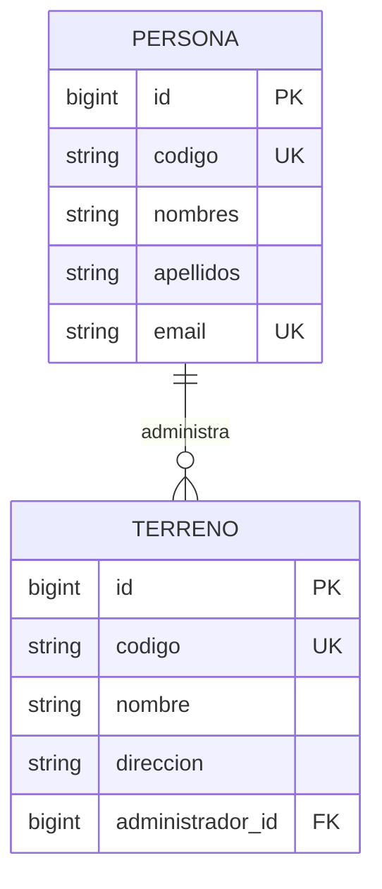

# SmartConnect · Primera entrega · Guía desde cero


## 1. Qué van a construir

Una API recibe peticiones y devuelve datos JSON. No necesitan crear una pantalla ni conectar una tarjeta RFID para este primer avance.

| Responsable propuesto | Módulo | URL local |
| --- | --- | --- |
| Integrante 1 | Personas | `http://127.0.0.1:8000/api/personas/` |
| Integrante 2 | Terrenos | `http://127.0.0.1:8000/api/terrenos/` |

CRUD significa crear, consultar, actualizar y eliminar. Cada módulo incluye esas operaciones. Los terrenos tienen un administrador que debe existir en Personas. Una persona puede administrar varios terrenos.

Los nombres reales de los integrantes, el repositorio, las ramas, los PR y las capturas deben aportarlos ustedes. Esta carpeta no acredita participación individual ni una prueba realizada en Apidog.

## 2. Qué necesitan en Windows

- Python 3.12 o 3.13 instalado y disponible como `py`.
- Un editor, por ejemplo VS Code.
- Git y una cuenta de GitHub para la evidencia solicitada.
- Apidog para ejecutar y guardar las peticiones.

Comprueben Python en una terminal PowerShell:

```powershell
py --version
```

Si usan `python` en su instalación, sustituyan `py` por `python` en el comando que crea el entorno. La base utiliza Django 5.2 y Django REST Framework 3.16.

## 3. Abrir el proyecto y preparar el entorno

Extraigan el ZIP. Abran la carpeta `smartconnect` en el editor. En PowerShell deben estar en la carpeta que contiene `manage.py`; compruébenlo con `Get-ChildItem`.

Ejecuten cada línea por separado:

```powershell
py -m venv .venv
.\.venv\Scripts\python.exe -m pip install -r requirements.txt
.\.venv\Scripts\python.exe manage.py migrate
.\.venv\Scripts\python.exe manage.py cargar_demo
.\.venv\Scripts\python.exe manage.py runserver
```

Se usa directamente el Python del entorno para que no tengan que cambiar la política de ejecución de PowerShell. No hace falta activar el entorno con `Activate.ps1`.

Qué hace cada paso:

1. `venv` crea una instalación de paquetes separada para el proyecto.
2. `pip install` instala Django y DRF.
3. `migrate` aplica las migraciones incluidas y crea `db.sqlite3`.
4. `cargar_demo` crea dos personas y tres terrenos relacionados. Se puede repetir sin duplicar estos datos; vuelve a poner sus valores de demostración.
5. `runserver` inicia la API. Dejen esa terminal abierta. Se detiene con `Ctrl+C`.

La primera vez no necesitan `makemigrations`: las dos migraciones iniciales ya están incluidas. Después de modificar modelos, ejecuten `manage.py makemigrations` y luego `manage.py migrate` usando el Python del entorno.

## 4. Confirmar el primer GET

Abrir en el navegador:

```text
http://127.0.0.1:8000/api/personas/
http://127.0.0.1:8000/api/terrenos/
```

Verán la interfaz de DRF. En Apidog, con `Accept: application/json`, la respuesta será JSON. Es el mismo contenido presentado por dos clientes distintos.

En una BD recién creada, Personas contiene a Ana Rojas y Diego Soto. Dos terrenos tienen a Ana como administradora y uno tiene a Diego. Esto demuestra la cardinalidad 1:N.

Los ID dependen de la base de datos. Revisen los ID reales en GET; no supongan que siempre son 1 y 2.

## 5. Entender los archivos

```text
petición → config/urls.py → views.py → serializers.py → models.py → SQLite
```

| Archivo | Qué explica cada integrante |
| --- | --- |
| `personas/models.py` | Campos y restricciones de Persona |
| `terrenos/models.py` | Campos de Terreno y ForeignKey hacia Persona |
| `personas/serializers.py` y `terrenos/serializers.py` | Representación JSON y validación de datos |
| `personas/views.py` y `terrenos/views.py` | Operaciones de ModelViewSet |
| `config/urls.py` | Registro de ambos recursos en DefaultRouter |
| `personas/migrations/` y `terrenos/migrations/` | Cambios que crean las tablas |
| `config/settings.py` | Aplicaciones instaladas y conexión SQLite |

`ForeignKey` guarda el ID de la persona administradora. `PROTECT` evita eliminar a alguien que todavía administra terrenos. La API responde 409 con una explicación; para eliminarlo hay que reasignar o eliminar antes esos terrenos. Esta es una decisión de la propuesta, no un código exigido por la pauta.

## 6. Probar ambos CRUD en Apidog

Sigan [docs/APIDOG.md](docs/APIDOG.md). Incluye ejemplos, orden de ejecución y resultados esperados. El archivo `docs/SmartConnect.postman_collection.json` contiene 18 peticiones para importar en Apidog como colección Postman v2.1.

| Petición | Operación | Respuesta correcta |
| --- | --- | --- |
| `GET /api/personas/` | Listar | 200 |
| `POST /api/personas/` | Crear | 201 |
| `GET /api/personas/{id}/` | Ver detalle | 200 |
| `PUT /api/personas/{id}/` | Actualizar todos los campos de entrada | 200 |
| `PATCH /api/personas/{id}/` | Cambiar algunos campos | 200 |
| `DELETE /api/personas/{id}/` | Eliminar una persona sin terrenos | 204, sin cuerpo |
| `GET /api/personas/{id}/` después de borrar | Verificar eliminación | 404 |

El patrón es igual para `/api/terrenos/`. Un cuerpo inválido devuelve 400.

## 7. Diagrama y decisiones de diseño

Lean [docs/DISENO.md](docs/DISENO.md). El diagrama v1 abarca el contexto completo; la BD inicial implementa únicamente Persona y Terreno. El resto está propuesto para futuras clases y debe revisarse con el docente.

La relación ya implementada es:



El diagrama completo está en la carpeta `er/`: [PNG](er/diagrama_er_v1.png) y [SVG ampliable](er/diagrama_er_v1.svg). El archivo [DOT](er/diagrama_er_v1.dot) conserva la fuente de la imagen.

También se incluye [el archivo nativo de draw.io](er/SmartConnect_ER_v1.drawio), con dos pestañas editables: el ER completo previsto y la BD inicial implementada.

## 8. Trabajar como pareja y dejar evidencia real

Antes de copiar este proyecto completo a `main`, acuerden con el docente cómo utilizar la base. Para demostrar trabajo individual, cada integrante debe implementar o adaptar su módulo, comprenderlo, hacer commits propios y recibir revisión del compañero.

Un flujo sugerido:

1. Creen un repositorio nuevo en GitHub para SmartConnect.
2. Suban a `main` el esqueleto común acordado: configuración, documentación y `.gitignore`.
3. Integrante 1 trabaja en la rama `feature/personas` y abre un PR con su CRUD.
4. El compañero revisa y se incorpora ese PR antes de integrar Terrenos, por su dependencia de Persona.
5. Integrante 2 trabaja en `feature/terrenos` y abre su PR.
6. El integrante 1 revisa ese PR. Ambos ejecutan los dos CRUD.
7. Guarden los enlaces de los PR y el hash del commit final.

No se han creado repositorios, ramas ni PR en sus cuentas. El material no debe presentarse como historial de contribuciones que todavía no ocurrió.

Ejemplo de comandos para una rama, dentro de un repositorio que ya clonaron y configuraron:

```powershell
git switch -c feature/personas
git status
git add personas
git commit -m "Implementa CRUD de personas"
git push -u origin feature/personas
```

Revisen los cambios antes del commit. Los archivos compartidos también deben incorporarse en el PR que corresponda. La migración de Terreno depende de la de Persona, por lo que deben coordinar ambas ramas. No suban `.venv`, `db.sqlite3`, contraseñas ni `__pycache__`.

Para obtener el hash al finalizar:

```powershell
git rev-parse HEAD
```

## 9. Pruebas y persistencia

En otra terminal, desde la carpeta de `manage.py`:

```powershell
.\.venv\Scripts\python.exe manage.py check
.\.venv\Scripts\python.exe manage.py test
```

Los cinco tests comprueban la secuencia de 18 peticiones, sus efectos en BD, validaciones, protección y reasignación del administrador, diferencias entre PUT/PATCH y carga repetible de datos. Usan una BD de prueba separada.

Para demostrar persistencia frente al docente, creen un registro, detengan y reinicien `runserver`, y vuelvan a consultar su ID. Debe seguir existiendo en `db.sqlite3`.

## 10. Qué falta para entregar

- [ ] Completar nombres, responsabilidades y supuestos del equipo.
- [ ] Revisar el ER v1 y justificar cardinalidades.
- [ ] Ejecutar migraciones y cargar datos ficticios relacionados.
- [ ] Ejecutar y guardar los dos CRUD en Apidog, con estados y cuerpos visibles.
- [ ] Capturar una relación y un caso de error por módulo.
- [ ] Comprobar persistencia tras reiniciar el servidor.
- [ ] Añadir enlaces del repositorio y los PR, y hash final.
- [ ] Cada integrante explica una decisión de diseño y los archivos de su CRUD.

Login, JWT, permisos de apertura, comprobación de proximidad, uso físico de RFID e integración con dispositivos corresponden a etapas posteriores. Los modelos previstos para esos temas aparecen en el diagrama, pero sus reglas todavía no están implementadas. Esta configuración es para ejecutar la práctica en localhost.

## 11. Si algo falla

| Mensaje o síntoma | Cómo resolverlo |
| --- | --- |
| `py` no se reconoce | Revisen la instalación de Python o usen `python` si está disponible |
| No encuentra `manage.py` | Abran la terminal dentro de `smartconnect` |
| `No module named django` | Instalen requirements con `.\.venv\Scripts\python.exe` y usen ese mismo ejecutable |
| `no such table` | Ejecuten `manage.py migrate` |
| Puerto 8000 ocupado | Ejecuten `manage.py runserver 8001` y cambien `base_url` en Apidog |
| POST devuelve 400 | Revisen el JSON de respuesta: explica el campo inválido o duplicado |
| URL de detalle devuelve 404 | Revisen el ID y la barra final `/` |
| DELETE devuelve 409 | La persona administra terrenos; reasignen esos terrenos antes de eliminarla |
| La segunda ejecución de la colección falla al crear | Una ejecución anterior pudo dejar `PER-PRUEBA` o `TER-PRUEBA`; eliminen solo esos registros de práctica, terreno primero |

- [Instalación oficial de Django 5.2](https://docs.djangoproject.com/en/5.2/intro/install/).
- [Modelos y migraciones en Django](https://docs.djangoproject.com/en/5.2/intro/tutorial02/).
- [Compatibilidad de DRF 3.16](https://www.django-rest-framework.org/community/3.16-announcement/).
- [Importación de colecciones Postman en Apidog](https://docs.apidog.com/import-from-postman-635043m0).
