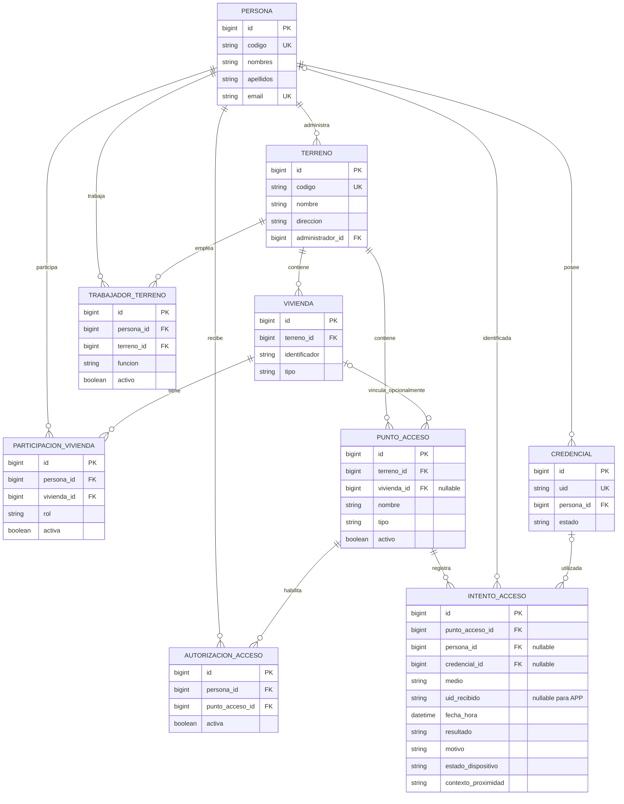

# Diseño v1 y supuestos propuestos

## Alcance

**Implementado en esta base:** tablas Persona y Terreno, migraciones, datos ficticios, relación administrador y los dos CRUD.

**Previsto para el proyecto:** vivienda, participación por vivienda, trabajadores, credenciales, puntos de acceso, autorizaciones e historial. Estos modelos aparecen en el diagrama para responder al contexto completo, pero no tienen tablas ni endpoints en la primera base. Deben actualizar el diagrama cuando incorporen las siguientes etapas.

## Cardinalidades y justificación

| Relación | Cardinalidad y opcionalidad | Justificación |
| --- | --- | --- |
| Persona administra Terreno | Persona 0..N terrenos; Terreno exactamente 1 administrador | El caso permite administrar varios terrenos y exige un responsable por terreno |
| Terreno contiene Vivienda | Terreno 0..N viviendas; Vivienda exactamente 1 terreno | Se permite registrar el terreno antes de cargar sus viviendas |
| Persona participa en Vivienda | M:N mediante ParticipacionVivienda | Una persona puede tener varias viviendas y una vivienda varias personas |
| Persona trabaja en Terreno | M:N mediante TrabajadorTerreno | Un trabajador puede acceder sin estar asociado a una vivienda |
| Persona posee Credencial | Persona 0..N credenciales; Credencial exactamente 1 titular | Supuesto: una persona puede tener tarjeta y llavero; cada UID tiene un único titular actual |
| Terreno contiene PuntoAcceso | Terreno 0..N puntos; PuntoAcceso exactamente 1 terreno | Cada acceso pertenece a un terreno |
| Vivienda vincula PuntoAcceso | Vivienda 0..N puntos; PuntoAcceso 0..1 vivienda | Supuesto: un acceso privado apunta a una vivienda; los comunes tienen vivienda vacía |
| Persona recibe AutorizacionAcceso | M:N con PuntoAcceso mediante AutorizacionAcceso | Permite autorizar un acceso concreto y denegar otro |
| PuntoAcceso registra IntentoAcceso | Punto 0..N intentos; Intento exactamente 1 punto | El historial debe indicar por dónde se intentó ingresar |
| Persona identificada en IntentoAcceso | Persona 0..N intentos; Intento 0..1 persona | Una credencial desconocida puede no identificar a nadie |
| Credencial utilizada en IntentoAcceso | Credencial 0..N intentos; Intento 0..1 credencial conocida | Solicitudes APP e intentos RFID desconocidos no necesitan una credencial registrada |

## Decisiones implementadas

1. `Persona.codigo` es un identificador ficticio único para practicar. No es un RUT ni incluye validación de RUT. El email también es único por simplicidad de esta propuesta.
2. `Terreno.administrador` es una ForeignKey obligatoria. Una persona puede administrar dos o más terrenos.
3. `on_delete=PROTECT` evita dejar un terreno sin administrador al eliminar una persona. La API captura ese caso y responde 409. Es posible reasignar el terreno y luego eliminar a su anterior administrador.
4. SQLite almacena los datos localmente y permite demostrar persistencia entre reinicios. El archivo se crea con `migrate` y se excluye de Git.

## Supuestos del diseño futuro para revisar con el docente

- El rol reside en ParticipacionVivienda, no en Persona. Sus valores previstos son `PROPIETARIO_ADMIN`, `PROPIETARIO`, `ARRENDATARIO` y `CONVIVIENTE`. Este último representa a quienes viven allí sin ser propietarios ni arrendatarios, como solicita documentar el caso. `PROPIETARIO_ADMIN` incluye la condición de propietario.
- Se propone una participación actual por par persona-vivienda, con unicidad conjunta `(persona_id, vivienda_id)`. Si se requiere historial de cambios de rol o varios roles simultáneos, se deberá ampliar este diseño.
- La unicidad de Vivienda será conjunta `(terreno_id, identificador)`: dos terrenos pueden tener una vivienda llamada Casa 1.
- TrabajadorTerreno es independiente de ParticipacionVivienda. Su unicidad conjunta será `(persona_id, terreno_id)` para la vinculación actual.
- Un punto de acceso puede vincularse con una vivienda del mismo terreno o ser común, dejando `vivienda_id` vacío. Hay que validar la coincidencia de terreno. Si un acceso debe asociarse a un subconjunto de varias viviendas, se necesita reemplazar esta relación por una tabla intermedia.
- La autorización será explícita por par persona-punto, con unicidad conjunta `(persona_id, punto_acceso_id)`. Vivir o trabajar en un terreno no autoriza automáticamente todos sus accesos. La regla que genera o revoca autorizaciones se definirá en clases posteriores.
- Se propone que un acceso requiera autorización activa, punto activo y, para RFID, credencial activa. Para APP también se comprobará la proximidad conforme a una simulación documentada o al mecanismo posterior. Estas reglas no se ejecutan en esta base.
- IntentoAcceso conservará fecha/hora con zona horaria, punto, persona identificada si existe, medio `RFID` o `APP`, resultado `PERMITIDO` o `DENEGADO` y motivo. Para una RFID desconocida, `persona_id` y `credencial_id` pueden estar vacíos, pero se conserva `uid_recibido` y el rechazo `CREDENCIAL_DESCONOCIDA`.
- Se conservará el contexto de proximidad de solicitudes APP. Su formato es una decisión pendiente; una simulación debe quedar identificada como tal.
- `resultado` expresa la decisión de autorización. `estado_dispositivo` distingue `NO_SOLICITADO`, `PENDIENTE`, `CONFIRMADO` o `FALLIDO`: autorizar no demuestra que una puerta abrió. La integración deberá validar combinaciones coherentes y, si requiere trazabilidad de cada confirmación, registrar eventos separados vinculados al intento.
- Se propone conservar referencias del historial con protección de borrado y desactivar personas/credenciales vinculadas en vez de borrarlas. La política y los campos necesarios se implementarán al incorporar el historial. La base inicial solo protege a quienes administran terrenos.
- La asociación futura entre Persona y un usuario autenticado debe definirse al incorporar JWT. Persona representa a alguien del dominio y no implica por sí sola una cuenta de acceso.

## Escenarios del caso y dónde quedan representados

| Escenario | Representación prevista |
| --- | --- |
| Persona con viviendas en dos terrenos | Dos ParticipacionVivienda, cuyas viviendas tienen terrenos distintos |
| Propietario administrador incorpora a arrendatario | Dos participaciones con roles distintos; la operación futura validará la autoridad sobre esa vivienda |
| Persona administra varios terrenos | Mismo administrador en varias filas de Terreno; ya se demuestra con Ana |
| Trabajador sin vivienda | TrabajadorTerreno y AutorizacionAcceso sin ParticipacionVivienda |
| Acceso permitido por una puerta y denegado por otra | AutorizacionAcceso distinta por punto; dos IntentoAcceso con resultados diferentes |
| Consultar historial por persona, terreno, acceso y fecha | Campos del intento y relación Intento → PuntoAcceso → Terreno; filtros pendientes de implementación |

## Guion breve para explicar la entrega

**Integrante 1:** “Persona contiene información de alguien del sistema. El serializer valida campos y convierte los objetos en datos de respuesta. ModelViewSet ofrece el CRUD. No guardamos un rol global porque una persona puede tener roles distintos según la vivienda.”

**Integrante 2:** “Cada terreno tiene un administrador obligatorio. La ForeignKey permite que una persona administre varios terrenos. Protegemos su eliminación mientras haya terrenos relacionados. Esa responsabilidad es distinta de administrar participantes de una vivienda.”

Adapten estas explicaciones con sus propias palabras y muestren las líneas correspondientes del código.

## Diagrama completo previsto

